# 🛡️ Awesome Remote Device Management & Remote Wipe

> 🌐 A curated directory of top-tier **Remote Device Management (MDM/UEM)** and **Remote Wipe** solutions — covering commercial enterprise SaaS platforms, cyber-resilient data sanitization tools, and open-source self-hosted fleet controllers for distributed workforces.

⭐ **Star this repository if you find it helpful!** ⭐

---

## 📋 Table of Contents

- [📊 Sector Overview & Market Dynamics](#-sector-overview--market-dynamics)
- [🟦 SaaS / Hosted Platforms](#-saas--hosted-platforms)
- [🟩 Open-Source Software](#-open-source-software)
- [⚖️ Comparison at a Glance](#️-comparison-at-a-glance)
- [💖 Support](#-support)
- [📈 Star History](#-star-history)
- [🤝 Contributing](#-contributing)
- [📄 License](#-license)

---

## 📊 Sector Overview & Market Dynamics

The global Unified Endpoint Management (UEM) and Mobile Device Management (MDM) market is valued at approximately **$10.5 billion to $13.5 billion in 2026** and is projected to surpass **$57 billion by 2034**, expanding at a robust compound annual growth rate (**CAGR of 21% to 24%**). 

The sector displays a **moderately concentrated, bifurcated market structure**: mega-cap enterprise suites (Microsoft Intune, Omnissa/VMware Workspace ONE) command substantial market share through operating system and enterprise identity bundle leverage, while specialized platforms (Jamf for Apple fleets, Druva for data-centric offline sanitization, and open-source control planes like Fleet) capture distinct enterprise segments demanding deep platform integration, cryptographic erasure, or independent sovereignty.

---

## 🟦 SaaS / Hosted Platforms

Commercial, cloud-hosted Unified Endpoint Management (UEM), Mobile Device Management (MDM), and Endpoint Data Protection platforms sorted by parent company scale (revenue / market valuation, descending).

| 🏢 Platform | 💰 Company Scale (Revenue / Valuation) | 💵 Starting Tier Pricing | 🎁 Free Tier / Free Trial Limits | 🔒 Wipe Mechanism & Scope | 🎯 Best For |
|:---|:---|:---|:---|:---|:---|
| [**Microsoft Intune**](https://www.microsoft.com/en-us/security/business/endpoint-management/microsoft-intune) | **~$245 Billion ARR** (Microsoft Corp Market Cap: ~$3.1 Trillion) | **$8.00** / user / month (Plan 1 standalone; annual commitment) | **30-day free trial** (up to 250 evaluation licenses with EMS/M365) | Native factory reset, selective enterprise wipe, eSIM preservation on Android Enterprise | Organizations invested in Microsoft 365 seeking native OS-level compliance |
| [**ManageEngine Endpoint Central**](https://www.manageengine.com/products/desktop-central/) | **~$1.2 Billion ARR** (Zoho Corporation Parent Valuation: ~$15 Billion) | **$1.09** / endpoint / month (Professional Edition, starting tier 50 devices at ~$795/yr) | **Free Forever up to 25 endpoints** (1 admin technician cap); **30-day trial** for Enterprise/UEM | Complete Wipe (factory reset) & Corporate Wipe (retraining personal BYOD files) | Mid-market and SMB enterprises wanting low-friction dual-wipe BYOD management |
| [**VMware Workspace ONE (Omnissa)**](https://www.omnissa.com/workspace-one/) | **~$4.0 Billion Private Equity Deal** (Acquired from Broadcom by KKR) | **$3.00** / device / month (Mobile Essentials tier, billed annually) | **30-day free trial** (available via authorized partner request/PoC) | Enterprise Wipe (containerized data removal) & Device Wipe (full factory erase) | Large-scale multi-OS enterprises requiring rigid BYOD container boundaries |
| [**Jamf Pro**](https://www.jamf.com/products/jamf-pro/) | **~$600 Million ARR** (Jamf Holding Corp Market Cap: ~$2.1 Billion) | **$3.33** / device / month for iOS/iPadOS; **$6.25** / device / month for macOS | **14-day full feature free trial** (no credit card required; 25-device minimum on paid contracts) | Remote Mac wipe via passcode/recovery PIN and instant APNs-driven iOS device erase | Dedicated Apple-exclusive enterprise and educational fleets (macOS, iOS, iPadOS) |
| [**Druva Endpoint Data Protection**](https://www.druva.com/solutions/endpoint-backup/) | **~$250 Million ARR** (Private Unicorn Valuation: ~$2.0 Billion) | **$6.00** / user / month (inSync Enterprise starting tier; annual commitment) | **30-day free trial** (cloud-native endpoint backup and automated DLP test) | Data-centric wipe with pre-wipe cloud snapshot; **offline timer wipe** & SIM-swap triggers | High-risk distributed workforces requiring data sanitization even when offline |

---

## 🟩 Open-Source Software

Self-hosted, community-audited device management frameworks and remote wipe agents sorted by GitHub star count (descending).

| 📦 Project | 🌟 GitHub Stars | 💻 Technology Stack | 📜 License | 🧰 Remote Wipe Capability | 💡 Architecture Highlights |
|:---|:---:|:---|:---|:---|:---|
| [**Fleet**](https://github.com/fleetdm/fleet) |  | Go • TypeScript • osquery | MIT | ✅ Native MDM remote wipe & lock (macOS, Windows, Linux, iOS, iPadOS) | GitOps-driven device management, real-time osquery-powered telemetry, zero-trust state enforcement |
| [**MicroMDM**](https://github.com/micromdm/micromdm) |  | Go • Apple MDM Protocol | MIT | ✅ `DeviceErase` command via Apple Push Notification service (APNs) | Modular microservices-ready Apple MDM server, headless API control, fast command queuing |
| [**NanoMDM**](https://github.com/micromdm/nanomdm) |  | Go • SQL / Redis | MIT | ✅ Apple MDM remote wipe & lock command handlers | Ultra-lightweight, high-throughput Apple MDM backend engine designed for high-density environments |
| [**Headwind MDM**](https://github.com/h-mdm/hmdm-server) |  | Java • PostgreSQL • Android | Apache-2.0 | ⚠️ Community edition supports lock/kiosk; factory reset API is in Premium edition | Open-core enterprise Android fleet management, dedicated kiosk launcher, and APK package push |
| [**Commandment**](https://github.com/cmdmnt/commandment) |  | Python • Flask • SQLAlchemy | MIT | ✅ Remote wipe command (`EraseDevice`) with Apple DEP enrollment | Pythonic Apple MDM implementation, profile generation, SCEP identity certificate payload provisioning |
| [**OpenUEM**](https://github.com/open-uem/openuem-console) |  | Go • NATS • Svelte | Apache-2.0 | 🔍 Inventory, remote lock & command exec (wipe capabilities in validation) | Modern microservice UEM with unified Windows, Linux, and macOS cross-platform endpoint agents |
| [**linDM**](https://github.com/radkawar/lindm) |  | Go • Linux Native Tools | Open Source | ✅ Cryptographic erasure (TPM / LUKS disk encryption key purging) | Dedicated Linux fleet management (Ubuntu, Debian, Fedora, RHEL, Arch) with peer-reviewed dual-approval wipe |
| [**SVT-MDM-Android**](https://github.com/adrianoftyriel/SVT-MDM-Android) |  | Kotlin • MQTT • HTTPS | Open Source | ✅ Immediate factory reset wipe via Android `DevicePolicyManager` API | Lightweight MQTT real-time command delivery, EncryptedSharedPreferences token store, 10-minute command expiry |
| [**DAWO Sextant**](https://codeberg.org/DAWO/DAWO-Sextant) | [Codeberg Repo](https://codeberg.org/DAWO/DAWO-Sextant) | NixOS • Rust • Go | EUPL-1.2 | ⚠️ Audit & lock intent spooled (destructive payload disabled by design in PoC) | Declarative GitOps pull control-plane for sovereign NixOS fleets developed for the Dutch public administration |

---

## ⚖️ Comparison at a Glance

| 🛠️ Platform | 📜 License | ☁️ Deployment | 🧼 Wipe Action Type | 🎯 Granular Corporate Wipe | 📴 Offline Auto-Wipe | 🖥️ Supported OS Platforms | 🏆 Best Use Case |
|:---|:---|:---|:---:|:---:|:---:|:---|:---|
| **Microsoft Intune** | Commercial | Cloud SaaS | Full Factory + Selective | ✅ Supported | ❌ | Windows, macOS, iOS, Android, ChromeOS | Standard Microsoft 365 corporate ecosystems |
| **Workspace ONE** | Commercial | Cloud SaaS | Full Factory + Enterprise Wipe | ✅ Supported | ❌ | Windows, macOS, iOS, Android, Linux | High-security segmented corporate BYOD |
| **ManageEngine Endpoint Central** | Commercial | Cloud / On-Prem | Complete Wipe + Corporate Wipe | ✅ Supported | ❌ | Windows, macOS, Linux, iOS, Android, tvOS | Cost-effective hybrid IT and SMB/mid-market |
| **Jamf Pro** | Commercial | Cloud SaaS | Erase Device + Recovery PIN | ⚠️ Apple Config Profiles | ❌ | macOS, iOS, iPadOS, tvOS | Specialized Apple device fleets |
| **Druva Endpoint** | Commercial | Cloud SaaS | Encrypted File Deletion + Backup | ✅ Supported | ✅ (Time / SIM Trigger) | Windows, macOS | Data loss prevention and distributed mobile executives |
| **Fleet** | MIT / Core | Cloud / Self-Hosted | Native MDM Wipe & Lock | ✅ MDM Profiles | ❌ | macOS, Windows, Linux, iOS, iPadOS | GitOps-driven security and osquery telemetry |
| **MicroMDM** | MIT | Self-Hosted | APNs EraseDevice | ⚠️ Profiles | ❌ | macOS, iOS, iPadOS | Scalable custom Apple fleet infrastructure |
| **NanoMDM** | MIT | Self-Hosted | MDM Protocol Erase | ⚠️ Profiles | ❌ | macOS, iOS, iPadOS | High-performance minimalist Apple MDM |
| **Headwind MDM** | Apache-2.0 | Self-Hosted / Cloud | Kiosk Reset (Premium API Wipe) | ⚠️ Custom APK | ❌ | Android | Android kiosks, industrial POS, logistics tablets |
| **Commandment** | MIT | Self-Hosted | APNs EraseDevice | ⚠️ Profiles | ❌ | macOS, iOS | Python-based Apple device lab testing |
| **OpenUEM** | Apache-2.0 | Self-Hosted | Remote Lock & Shell Exec | 🔍 Under Test | ❌ | Windows, Linux, macOS | Open-source cross-platform IT asset governance |
| **linDM** | Open Source | Self-Hosted | LUKS / TPM Crypto-Erasure | ❌ (Full Crypto-Wipe) | ❌ | Linux (Debian, Ubuntu, Fedora, RHEL, Arch) | Dedicated enterprise Linux developer machines |
| **SVT-MDM** | Open Source | Self-Hosted | Device Admin Factory Wipe | ❌ (Full Reset) | ❌ | Android | Lightweight Android edge devices |
| **DAWO Sextant** | EUPL-1.2 | Self-Hosted | Declarative Lock Intent | ❌ (PoC Phase) | ❌ | NixOS | Sovereign declarative NixOS infrastructure |

---

## 💖 Support

Thank you so much for exploring and supporting **Awesome Remote Device Management & Remote Wipe**! 🙏

If you find this repository valuable:
- ⭐ **Star** this repository to show your appreciation and help others discover it.
- 🍴 **Fork** it to keep your own reference and contribute improvements back.
- 📢 **Share** it with fellow system administrators, security analysts, and DevOps engineers.
- ☕ **Buy me a coffee / Sponsor:** If you'd like to support ongoing maintenance and new curated lists, consider sponsoring via the [GitHub Sponsor Dashboard](https://github.com/sponsors/ishandutta2007).

---

## 📈 Star History

---

## 🤝 Contributing

Contributions to **Awesome Remote Device Management & Remote Wipe** are always welcome! 

Whether you are adding a new open-source MDM platform, updating enterprise pricing nuances, or suggesting architectural improvements:

1. 🍴 **Fork** the repository.
2. 🌿 **Create a new branch** (`git checkout -b feature/cool-mdm-tool`).
3. 📝 **Add your tool** following our tabular format (including stack, license, remote wipe mechanism, and GitHub star badge).
4. ✅ **Ensure accuracy** regarding wipe verification (differentiate whether wipe is full factory, selective corporate, crypto-erasure, or unverified).
5. 🚀 **Submit a Pull Request** with a clear description of the project.

---

## 📄 License

This repository and compilation are licensed under the [Creative Commons Zero v1.0 Universal](LICENSE) (Public Domain Dedication).  
Individual tools and platforms referenced retain their respective trademarks, copyrights, and open-source licenses.

---

  Maintained with ❤️ for system administrators, DevOps engineers, and Infosec specialists worldwide. 
  <b><a href="#awesome-remote-device-management--remote-wipe">⬆️ Back to Top</a></b>

